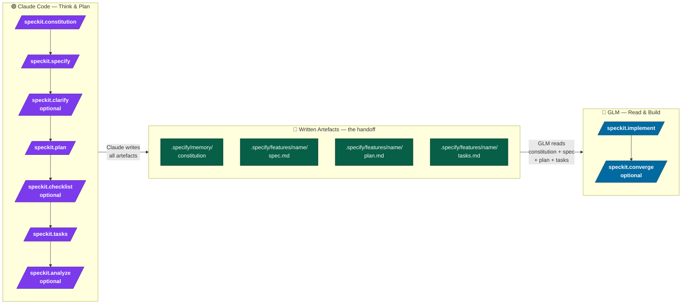

# Spec Kit

**Spec Kit** is a spec-driven development framework that imposes discipline on how features are conceived, specified, planned, and built. Instead of jumping straight to code, every piece of work starts from a living specification that is grounded in a permanent set of engineering standards — the **constitution** — so that each feature is consistent, traceable, and maintainable from day one.

The workflow is deliberate: you define your project's non-negotiable engineering principles once (the constitution), then for every feature you write a specification, plan the implementation, and only then build. The result is a codebase where every decision is documented, every feature is aligned with the same standards, and future changes — additions, updates, spec corrections — follow the same traceable path.

---

## Core Concepts

| Concept | What it is |
| --- | --- |
| **Constitution** | Permanent engineering standards for the whole project (architecture, security, testing, coding rules). Written once, inherited by every feature forever. |
| **Specification** | A feature-level document defining user stories, business rules, acceptance criteria, and out-of-scope boundaries. Written before any code. |
| **Plan** | A technical implementation plan derived from the specification, describing layers, classes, migrations, and tests to be written. |
| **Implementation** | The actual code, produced by an AI agent that follows the constitution and the plan simultaneously. |

---

## Full Lifecycle Diagram

The diagram below shows every path through Spec Kit — initial setup, normal feature development, spec corrections, adding new features after the codebase exists, and updating existing features.

> **Legend — `✦ MANDATORY` · `◇ OPTIONAL`**

```mermaid
flowchart TD
    classDef mandatory fill:#1d4ed8,stroke:#1e3a8a,color:#fff,font-weight:bold
    classDef optional  fill:#6b7280,stroke:#374151,color:#fff,font-style:italic
    classDef decision  fill:#b45309,stroke:#78350f,color:#fff
    classDef loop      fill:#065f46,stroke:#022c22,color:#fff

    %% ─── SETUP PHASE ───────────────────────────────────────────────────
    A([🚀 Start New Project]):::mandatory
    B[Install uv & Spec Kit CLI\n`uv tool install specify-cli`]:::mandatory
    C[Initialise project\n`specify init <name>`]:::mandatory
    D{Agent integration\nneeded?}:::decision
    E[Add integration at init\n`--integration copilot` or `cline`]:::optional
    F[Add integration post-init\n`specify integration install copilot`]:::optional
    G[Skip integration\nuse CLI only]:::optional

    A --> B --> C --> D
    D -- Yes, at init --> E --> H
    D -- Yes, post-init --> F --> H
    D -- No --> G --> H

    %% ─── CONSTITUTION PHASE ─────────────────────────────────────────────
    H[Prepare constitution prompt\ntech stack · architecture · security\ntesting · coding standards]:::mandatory
    I[Run /speckit.constitution\nwith prompt content]:::mandatory
    J[Review generated constitution\nin .specify/memory]:::mandatory
    K{Constitution\ncovers all standards?}:::decision
    L[Refine prompt & re-run\n/speckit.constitution]:::loop

    H --> I --> J --> K
    K -- No → iterate --> L --> I
    K -- Yes --> M

    %% ─── FEATURE SPECIFICATION PHASE ────────────────────────────────────
    M([✦ Feature Work Begins]):::mandatory
    N[Write feature requirements\nuser stories · business rules\nacceptance criteria · out-of-scope]:::mandatory
    O[Run /speckit.specify\nwith requirements]:::mandatory
    P[Review generated specification\nin .specify/features/]:::mandatory
    Q{Specification\ncorrect & complete?}:::decision
    R[Correct requirements &\nre-run /speckit.specify]:::loop

    M --> N --> O --> P --> Q
    Q -- No → iterate --> R --> O
    Q -- Yes --> S

    %% ─── PLANNING PHASE ─────────────────────────────────────────────────
    S[Run /speckit.plan\nwith implementation notes]:::mandatory
    T[Review generated plan\nlayers · classes · migrations · tests]:::mandatory
    U{Plan aligns with\nspec & constitution?}:::decision
    V[Adjust implementation notes\n& re-run /speckit.plan]:::loop
    W[Add architectural notes\nto plan]:::optional

    S --> T --> U
    U -- No → iterate --> V --> S
    U -- Yes --> W --> X

    %% ─── IMPLEMENTATION PHASE ────────────────────────────────────────────
    X[Implement feature\nfollowing plan + constitution]:::mandatory
    Y[Run tests & verify\nunit · integration · slice tests]:::mandatory
    Z{All tests pass\n& coverage met?}:::decision
    AA[Fix failing tests\nor missing coverage]:::loop

    X --> Y --> Z
    Z -- No → fix --> AA --> Y
    Z -- Yes --> AB

    %% ─── POST-IMPLEMENTATION DECISIONS ──────────────────────────────────
    AB{What happens next?}:::decision

    AB -- Feature complete,\nno changes --> AC
    AB -- Spec has an error\nor gap found --> AD
    AB -- Add a new feature\nto the project --> AG
    AB -- Update an existing\nfeature --> AJ
    AB -- Refactor without\nchanging behaviour --> AM

    %% ─── PATH 1: DONE ────────────────────────────────────────────────────
    AC([✅ Feature Shipped]):::mandatory

    %% ─── PATH 2: SPEC CORRECTION ─────────────────────────────────────────
    AD[Identify what is wrong\nin the specification]:::mandatory
    AE[Update requirements & re-run\n/speckit.specify on the feature]:::mandatory
    AF[Re-run /speckit.plan\nif plan is affected]:::optional

    AD --> AE --> AF --> X

    %% ─── PATH 3: NEW FEATURE ─────────────────────────────────────────────
    AG[New feature requirements\nuser stories · business rules]:::mandatory
    AH[Run /speckit.specify\nfor the new feature]:::mandatory
    AI[Run /speckit.plan\nfor the new feature]:::mandatory

    AG --> AH --> AI --> X

    %% ─── PATH 4: UPDATE EXISTING FEATURE ────────────────────────────────
    AJ[Document what changes\n& why — delta requirements]:::mandatory
    AK[Re-run /speckit.specify\nwith updated requirements]:::mandatory
    AL[Re-run /speckit.plan\nreferencing changed spec sections]:::mandatory

    AJ --> AK --> AL --> X

    %% ─── PATH 5: REFACTOR ────────────────────────────────────────────────
    AM[Confirm zero behaviour change\ndocument refactor goal]:::mandatory
    AN[Update constitution if a new\nstandard is being formalised]:::optional
    AO[Implement refactor — no spec\nor plan update needed]:::optional

    AM --> AN --> AO --> Y
```



---

## Mandatory vs Optional Steps

The diagram below strips away the branching logic and focuses on one question: **what must you do, and what can you skip?** Each phase is shown as a swim lane so you can see at a glance which steps are non-negotiable and which are situational.


### What the colours mean

| Colour | Meaning |
| --- | --- |
| 🔵 **Blue** | **Mandatory** — skipping this step breaks the workflow |
| ⚫ **Grey** | **Optional** — situational; skip when not needed |

### Optional steps decoded

| Step | When to include it |
| --- | --- |
| Add agent integration at init | You want Copilot or Cline to drive implementation |
| Add agent integration post-init | You forgot at init, or switched agent later |
| Iterate constitution prompt | First draft does not fully capture your standards |
| Iterate spec | A requirement was wrong, ambiguous, or missing |
| Iterate plan | Plan does not match the spec or violates the constitution |
| Annotate plan with architectural notes | Non-obvious design decisions need documenting |
| Fix failures & boost coverage | Tests fail or coverage is below target after first run |

---

## Step-by-Step Walkthrough

### Phase 1 — Setup ✦ Mandatory

1. Install `uv` (the package manager Spec Kit ships through).
2. Install the `specify-cli` tool via `uv tool install specify-cli`.
3. Initialise a project with `specify init <name>`.
4. Optionally wire up an AI agent integration at init time (`--integration copilot`) or post-init (`specify integration install copilot`). Without an integration the CLI works standalone.

### Phase 2 — Constitution ✦ Mandatory

The constitution is the single source of truth for all engineering standards. It is created **once** at project start and lives in `.specify/memory`. Every future feature inherits it automatically.

- Prepare a constitution prompt covering: technology stack, architecture style, API design, security, persistence, testing strategy, observability, and coding standards.
- Run `/speckit.constitution <prompt>` inside your agent.
- Review the generated files in `.specify/memory` and iterate until the constitution fully reflects your standards.

> A constitution is permanent. If a standard needs to change across the whole project, update the constitution — not individual features.

### Phase 3 — Specify ✦ Mandatory (per feature)

For every feature, before any code is written:

- Write requirements: user stories (with priority), business rules, acceptance criteria (Given/When/Then), and an explicit out-of-scope list.
- Run `/speckit.specify <requirements>`.
- Review the generated specification in `.specify/features/`.
- Iterate until the specification is complete and accurate.

### Phase 4 — Plan ✦ Mandatory (per feature)

- Pass implementation notes to `/speckit.plan`.
- Review the generated plan: which layers are touched, which classes are created, which migrations are needed, which tests are required.
- Iterate until the plan aligns with both the specification and the constitution.
- Optionally annotate the plan with architectural decisions or trade-offs.

### Phase 5 — Implement ✦ Mandatory (per feature)

- Build following the plan and constitution simultaneously.
- Run unit, integration, and slice tests.
- Iterate until all tests pass and coverage targets are met.

---

## Real-World Variations

### 🔁 Spec Correction — Error or gap found in an existing specification

Sometimes a specification is approved, development starts, and an incorrect business rule or a missing acceptance scenario surfaces. The correct path:

1. Identify exactly what is wrong or missing in the specification.
2. Update the requirements and re-run `/speckit.specify` on the affected feature — this keeps `.specify/features/` as the living record.
3. If the plan's task list or class structure is affected, re-run `/speckit.plan` too. Otherwise skip it.
4. Resume implementation from where you left off.

> Never patch the code and leave the specification out of date. The specification is the contract; the code should always match it.

---

### ➕ Adding a New Feature to an Established Codebase

The constitution already exists. The path is shorter:

1. Write requirements for the new feature (user stories, business rules, acceptance criteria).
2. Run `/speckit.specify` — the new specification is added to `.specify/features/` alongside existing ones.
3. Run `/speckit.plan` — the plan is aware of existing code and should reference reusable components.
4. Implement, following both the new plan and the unchanged constitution.

> Never skip `/speckit.specify` for a "small" feature. Even small features benefit from a clear out-of-scope boundary and traceable acceptance criteria.

---

### ✏️ Updating an Existing Feature

Business requirements evolve. An endpoint gains a new required field, a business rule changes, a new acceptance scenario is added. The correct path:

1. Document the delta — what is changing and why (new business rules, changed acceptance criteria, removed constraints).
2. Re-run `/speckit.specify` with the updated full requirements for the feature. The specification is replaced, not patched inline.
3. Re-run `/speckit.plan` referencing the changed specification sections.
4. Implement the delta, run the full test suite (not just the new tests), confirm no regressions.

> Treat the updated specification as a new contract. Existing tests that now contradict the new spec must be updated — not deleted — to reflect the evolved behaviour.

---

### 🔧 Constitution Update — A Standard Changes Project-Wide

A new security requirement arrives, a library is upgraded across the board, or the team adopts a new logging strategy. Because the constitution is inherited by every future feature:

1. Update the constitution prompt to reflect the new standard.
2. Re-run `/speckit.constitution` to regenerate `.specify/memory`.
3. Review the diff — confirm the change is correctly captured.
4. For already-implemented features, apply the change as a **refactor** (see below), referencing the updated constitution as the authority.

---

### ♻️ Refactor — Improve Structure Without Changing Behaviour

Refactors do not change acceptance criteria or business rules — they change how the code is organised internally. No specification or plan update is needed unless the refactor formalises a new architectural standard.

1. Confirm there is zero behaviour change — write characterisation tests first if coverage is low.
2. If the refactor formalises a new standard (e.g., "all mappers must be static factory classes"), update the constitution so future features inherit it.
3. Implement the refactor.
4. Run the full test suite. All tests must pass without modification — if a test must change, it is not a pure refactor.

---

### 🚨 Hotfix — Emergency Fix in Production

A production defect needs an immediate fix. The path balances speed with traceability:

1. Fix the defect in the code.
2. Add or update the test that proves the defect is fixed (regression test).
3. After the fix ships, update the specification's acceptance criteria to cover the previously missing scenario — close the specification gap.
4. If the root cause points to a gap in the constitution (e.g., a missing input-validation rule), update the constitution too.

> Speed is acceptable in a hotfix. Leaving the specification permanently out of sync is not.

---

### 🔀 Parallel Feature Development

Multiple features in flight simultaneously. Each feature has its own specification and plan in `.specify/features/`. The constitution is shared and must not be modified by individual feature branches.

- Merge constitution changes through a dedicated branch and communicate to all feature branches.
- If two features touch the same domain area, co-author the specifications before planning either — conflicting acceptance criteria surface in writing, not in code review.

---

## Quick Reference — Commands

| Command | Phase | Mandatory? |
| --- | --- | --- |
| `brew install uv` | Setup | ✦ |
| `uv tool install specify-cli` | Setup | ✦ |
| `specify init <name>` | Setup | ✦ |
| `specify init <name> --integration copilot\|cline` | Setup | ◇ |
| `specify init .` | Setup | ◇ |
| `specify integration install copilot` | Setup | ◇ |
| `/speckit.constitution <prompt>` | Constitution | ✦ |
| `/speckit.specify <requirements>` | Specify | ✦ |
| `/speckit.plan <implementation notes>` | Plan | ✦ |
| Implement + test suite | Implementation | ✦ |

---

## File Layout After Init

```
.specify/
  memory/          ← Constitution lives here (project-wide standards)
  features/        ← One spec file per feature
.github/           ← Copilot integration files (if --integration copilot)
.clinerules        ← Cline integration file (if --integration cline)
```

---

## Dual-LLM Workflow — Claude for Planning, GLM for Implementation

Spec Kit's written artefacts (constitution, spec, plan, task list) act as a clean handoff boundary between models. You are not locked to one LLM for the entire lifecycle.

> **Claude Code** ([claude.ai/code](https://claude.ai/code)) — best for reasoning, structured documents, and surfacing edge cases.
> **GLM** ([z.ai](https://z.ai)) — best for fast, plan-following code generation.



### The handoff rule

**When `.specify/features/<name>/tasks.md` exists and looks correct in Claude, you are ready to switch to GLM.** The task list is the signal. Do not switch mid-clarify or mid-plan.

### Tips

- Run `/speckit.analyze` in Claude before switching — it catches spec-vs-plan mismatches before GLM writes any code.
- Pass the **full constitution** to GLM, not just the plan. GLM needs the engineering standards to make correct micro-decisions.
- After each GLM implement cycle, run your test suite — tests are the objective check that GLM's output matches the intent Claude expressed in the plan.
- If convergence finds gaps, decide which model to use: GLM for mechanical missing tasks, Claude if the gap requires re-thinking the plan.

For the full step-by-step walkthrough see the [Using Two LLMs Together](specKit.md#using-two-llms-together--planning-with-claude-implementation-with-glm) section in `specKit.md`.

---

## See Also

- [`specKit.md`](specKit.md) — Detailed installation and setup guide
- [`speckit-constitution-prompt.txt`](speckit-constitution-prompt.txt) — Example constitution prompt for a Java Spring Boot microservice
- [`speckit-specify-prompt.txt`](speckit-specify-prompt.txt) — Example `/speckit.specify` prompt for a User Registration feature
- [`speckit-plan-prompt.txt`](speckit-plan-prompt.txt) — Example `/speckit.plan` prompt for the same feature
