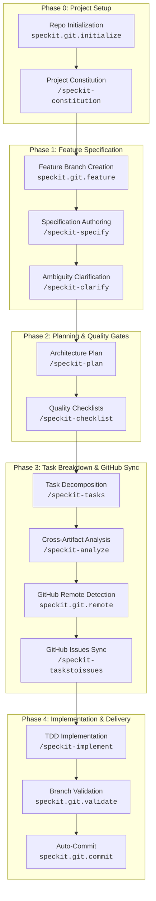

# SecKit: Java Spring Boot & Spec Kit GitHub Workflow

[](https://openjdk.org/)
[](https://spring.io/projects/spring-boot)
[](.specify/memory/constitution.md)
[](.specify/)

---

## Table of Contents

- [Overview](#overview)
- [Spec Kit GitHub & Git Workflow](#spec-kit-github--git-workflow)
  - [Workflow Lifecycle Diagram](#workflow-lifecycle-diagram)
  - [Step-by-Step Command Sequence](#step-by-step-command-sequence)
- [Spec Kit Git & GitHub Commands Reference](#spec-kit-git--github-commands-reference)
- [Extension Hooks System](#extension-hooks-system)
- [Configuration Guide](#configuration-guide)
- [Application Architecture & Features](#application-architecture--features)
- [Quickstart: Build & Run](#quickstart-build--run)

---

## Overview

**seckit_JavaSpringProject** is a reference production-grade Spring Boot 4 microservice implementing a secure **User Registration** system designed under strict **Clean Architecture** principles.

The project lifecycle is fully governed by **Spec Kit** — a specification-driven development toolkit that integrates directly with Git and GitHub to automate repository initialization, sequential feature branching, specification clarification, architecture planning, task decomposition, GitHub issue synchronization, and TDD implementation.

---

## Spec Kit GitHub & Git Workflow

Spec Kit organizes feature development into a deterministic, traceable pipeline. The Git extension manages branching, commits, and GitHub issue synchronization at each stage.

### Workflow Lifecycle Diagram



---

### Step-by-Step Command Sequence

Here is the exact sequence of commands to develop a feature using Spec Kit and its Git/GitHub integration:

#### Step 1: Initialize Git Repository
Before starting project governance, initialize the Git repository with a baseline commit:
```text
speckit.git.initialize
```
- **What it does**: Checks if a Git repository exists. If not, initializes `git init`, stages files, and creates an initial commit (`"[Spec Kit] Initial commit"`).
- **Trigger**: Runs automatically as a `before_constitution` mandatory hook, or can be run manually via `.specify/extensions/git/scripts/bash/initialize-repo.sh`.

#### Step 2: Establish Project Constitution
```text
/speckit-constitution
```
- **What it does**: Defines core architectural invariants, clean code constraints, tech stack rules, and testing mandates in `.specify/memory/constitution.md`.

#### Step 3: Create Feature Branch & Write Specification
```text
/speckit-specify Create user registration with email uniqueness and BCrypt hashing
```
- **Automatic Pre-Hook**: `speckit.git.feature`
  - Calculates the next sequential branch number (e.g., `001-user-registration` or timestamp `20261019-153000-user-registration`).
  - Creates and checks out the new feature branch.
- **What `/speckit-specify` does**: Generates `specs/<feature-id>/spec.md` containing user stories, functional requirements, and acceptance criteria.
- **Optional Post-Hook**: `speckit.git.commit` stages and commits the new specification.

#### Step 4: Clarify Underspecified Areas
```text
/speckit-clarify
```
- **What it does**: Scans the specification for ambiguities, generates up to 5 targeted questions, records decisions, and updates `spec.md`.

#### Step 5: Generate Technical Implementation Plan
```text
/speckit-plan
```
- **What it does**: Evaluates the specification against the Constitution and creates:
  - `plan.md`: Target architecture, module dependencies, and execution phases.
  - `research.md`: Technology choices, trade-offs, and alternatives.
  - `data-model.md`: Domain entities, value objects, and database schemas.
  - `contracts/`: Form binding objects, REST/MVC endpoints, and validation contracts.
  - `quickstart.md`: Verification walkthrough.

#### Step 6: Create Verification Checklists
```text
/speckit-checklist
```
- **What it does**: Generates quality gate checklists in `specs/<feature-id>/checklists/` (e.g., `requirements.md`, `registration.md`) covering UX, security, persistence, and performance.

#### Step 7: Generate Dependency-Ordered Tasks
```text
/speckit-tasks
```
- **What it does**: Decomposes the plan into sequential and parallel (`[P]`) tasks across 4 phases: Setup, Foundational, User Stories (TDD), and Polish in `specs/<feature-id>/tasks.md`.

#### Step 8: Perform Cross-Artifact Consistency Analysis
```text
/speckit-analyze
```
- **What it does**: Validates consistency between `spec.md`, `plan.md`, and `tasks.md` to ensure zero coverage gaps, duplicate IDs, or missing dependencies before writing code.

#### Step 9: Sync Tasks to GitHub Issues
```text
/speckit-taskstoissues
```
- **Automatic Remote Detection**: `speckit.git.remote`
  - Inspects `git config --get remote.origin.url`.
  - Verifies that the remote is an authentic GitHub repository (`https://github.com/<owner>/<repo>` or `git@github.com:<owner>/<repo>`).
- **What `/speckit-taskstoissues` does**:
  - Creates a GitHub Milestone named after the feature (e.g., `001-user-registration`).
  - Transforms each task in `tasks.md` into an actionable GitHub Issue with task metadata, file links, and dependencies.
  - Sets appropriate labels (`setup`, `foundational`, `user-story`, `polish`, `testing`).

#### Step 10: Execute Implementation & Verification
```text
/speckit-implement
```
- **What it does**:
  1. Verifies prerequisites and ensures all checklists are passing (`✓ PASS`).
  2. Implements domain entities, use cases, ports, adapters, controllers, and templates following TDD.
  3. Executes test suites (`EmailTest`, `UserTest`, `RegisterUserUseCaseTest`, `RegistrationControllerTest`, `SpringDataUserRepositoryTest`, `UserRegistrationIntegrationTest`).
  4. Automatically marks completed tasks as `[X]` in `tasks.md`.
  5. Executes `./mvnw clean verify`.
- **Optional Post-Hook**: `speckit.git.commit` commits implementation changes.

---

## Spec Kit Git & GitHub Commands Reference

| Command | Type | Description | Script Path |
| :--- | :--- | :--- | :--- |
| `speckit.git.initialize` | Git Core | Initializes a local git repository and creates the baseline commit. | `.specify/extensions/git/scripts/bash/initialize-repo.sh` |
| `speckit.git.feature` | Git Core | Calculates sequential/timestamp number and creates a feature branch. | `.specify/extensions/git/scripts/bash/create-new-feature.sh` |
| `speckit.git.validate` | Git Core | Verifies the current branch follows the naming pattern (`^[0-9]{3,}-` or timestamp). | Native git check (`git rev-parse --abbrev-ref HEAD`) |
| `speckit.git.remote` | GitHub Integration | Detects and parses the GitHub repository owner and repository name from `remote.origin.url`. | Native git check (`git config --get remote.origin.url`) |
| `speckit.git.commit` | Git Core | Auto-stages and commits changes after any workflow lifecycle step. | `.specify/extensions/git/scripts/bash/auto-commit.sh` |
| `/speckit-taskstoissues` | GitHub Integration | Converts markdown tasks from `tasks.md` into synchronized GitHub Milestone issues. | Driven by GitHub MCP / GitHub REST API |

---

## Extension Hooks System

Spec Kit uses an event-driven hook system configured in `.specify/extensions.yml`. Hooks execute before or after core commands:

```yaml
hooks:
  before_constitution:
    - extension: git
      command: speckit.git.initialize
      enabled: true
      optional: false       # Mandatory: automatically initializes repo

  before_specify:
    - extension: git
      command: speckit.git.feature
      enabled: true
      optional: false       # Mandatory: automatically creates feature branch

  before_taskstoissues:
    - extension: git
      command: speckit.git.commit
      enabled: true
      optional: true        # Prompt user to commit before syncing GitHub issues

  after_implement:
    - extension: git
      command: speckit.git.commit
      enabled: true
      optional: true        # Prompt user to commit after implementation finishes
```

---

## Configuration Guide

Git extension settings are defined in `.specify/extensions/git/git-config.yml`:

```yaml
# Branch numbering strategy: "sequential" (001, 002) or "timestamp" (20261019-143000)
branch_numbering: sequential

# Default initial commit message
init_commit_message: "[Spec Kit] Initial commit"

# Auto-commit toggles per lifecycle hook
auto_commit:
  default: false
  after_specify:
    enabled: true
    message: "[Spec Kit] Add feature specification"
  after_plan:
    enabled: true
    message: "[Spec Kit] Add technical architecture plan"
  after_implement:
    enabled: true
    message: "[Spec Kit] Implement feature and pass automated test suite"
```

---

## Application Architecture & Features

The reference implementation in this repository follows strict Clean Architecture:

```
src/main/java/com/gohar/platform/seckit/
├── domain/                      # Core business logic (Zero framework dependencies)
│   ├── model/                   # User, UserId, Email, HashedPassword, UserStatus
│   └── exception/               # DuplicateEmailException, DomainValidationException
├── application/                 # Use cases and boundary ports
│   ├── command/                 # RegisterUserCommand
│   ├── result/                  # RegisterUserResult
│   ├── ports/                   # UserRepositoryPort, PasswordEncoderPort
│   └── usecases/                # RegisterUserUseCase (Single public execute method)
├── infrastructure/              # Framework adapters and third-party tools
│   ├── persistence/             # UserJpaEntity, SpringDataUserRepository, UserRepositoryAdapter
│   ├── security/                # BCryptPasswordEncoderAdapter (cost 12), SecurityConfiguration
│   └── ratelimit/               # RegistrationRateLimitFilter (Sliding window 5 req/min per IP -> 429)
└── presentation/                # UI controllers, forms, and views
    ├── controller/              # RegistrationController (PRG pattern), LoginController
    └── form/                    # RegistrationForm (Bean Validation, password wiping)
```

---

## Quickstart: Build & Run

### Prerequisites
- **JDK 25** (`java -version`)
- **Maven Wrapper** (bundled `./mvnw`)

### Running the Test Suite
```bash
./mvnw clean verify
```
*Executes all 50 unit tests, MVC slice tests, JPA repository slice tests, and SpringBootTest integration tests.*

### Starting the Application Locally
```bash
./mvnw spring-boot:run
```

- **Registration Page**: [http://localhost:8080/register](http://localhost:8080/register)
- **Login Landing Page**: [http://localhost:8080/login](http://localhost:8080/login)
- **Actuator Health Check**: [http://localhost:8080/actuator/health](http://localhost:8080/actuator/health)